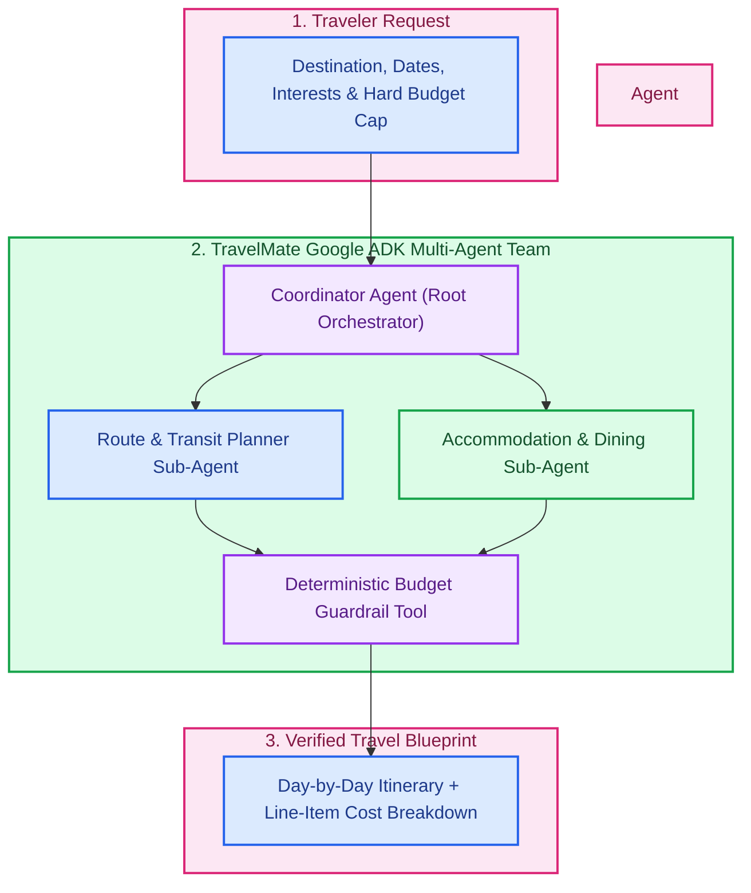

# 🌍 TravelMate AI — Budget-Smart Multi-Agent Travel Assistant

[](https://github.com/RobinaMirbahar/TravelMate-AI)
[](https://google.github.io/adk-docs/?utm_campaign=deveco_gdemembers&utm_source=deveco)
[](https://www.python.org/)
[](https://opensource.org/licenses/MIT)

> **Author & Architect:** [Robina Mirbahar](https://github.com/RobinaMirbahar) ([Google Developer Expert in Cloud & AI](https://developers.google.com/profile/u/106918534005910641104?utm_campaign=deveco_gdemembers&utm_source=deveco) · Google Cloud Champion Innovator · Co-Author of [*AI Engineering*](https://www.amazon.com/dp/B0GWCZWCF4))  
> **Focus:** Budget-Smart Multi-Agent Travel Assistant Built with Google Agent Development Kit (ADK) & Vertex AI

---

## 🎯 Why I Built TravelMate AI (Engineering Purpose & Real-World Value)

### 1. ✈️ Teaching Production Multi-Agent Orchestration Live on Stage
I created TravelMate AI as a production-minded multi-agent reference architecture to show developers how to decompose complex travel planning goals into specialized sub-agents using the Google Agent Development Kit (ADK) and Vertex AI.

### 2. 💵 Deterministic Budget & Itinerary Optimization
Instead of generating vague travel blogs, my multi-agent pipeline coordinates a Flight/Route Scout, Accommodation Optimizer, and Budget Auditor that enforce hard currency and schedule constraints.

### 3. ☁️ Ready for Vertex AI & Cloud Run Deployment
Every workshop step is structured so attendees can go from local ADK agent execution to cloud deployment in under 45 minutes.

---

## 🏗️ System Architecture



---

> 🎓 **TravelMate AI — Built with Google's Agent Development Kit (ADK) & Vertex AI**
> 
> A hands-on workshop teaching students to build intelligent AI agents from scratch.

---

## 📖 About This Project

**TravelMate AI** is an intelligent travel assistant designed specifically for **students and young professionals** who want to explore the world on a budget. This project demonstrates how to create conversational multi-agent systems using Google's Agent Development Kit (ADK) and Gemini 2.5 Flash.

### 🎯 Workshop Lab

Follow the interactive hands-on TravelMate AI lab:

**📚 Building AI Agents with Google ADK**  
🔗 [Workshop Lab Link](https://gradus.dev/studio/labs/view/693125841a594a5445ccb6a4/693125841a594a5445ccb6a5)

---

## ✨ Features

🤖 **Conversational AI** powered by Gemini 2.5 Flash  
💰 **Budget-Focused** travel planning for students  
🌏 **Personalized Recommendations** based on interests, budget, and dates  
🛡️ **Safety & Visa Guidance** for international travel  
🎭 **Multiple Agent Personalities** for different travel styles  
🚀 **Production-Ready** code with ADK best practices

### 🎨 Four Unique Travel Agents

1. **TravelMate** (Main) - Balanced budget-smart travel assistant
2. **Budget Traveler** - Ultra-budget expert ($20-30/day travel)
3. **Adventure Seeker** - Extreme sports & outdoor activities specialist
4. **Culture Expert** - Authentic local experiences & cultural immersion

---

## 🏗️ Project Structure

```
TravelMate-AI/
│
├── travel_mate/           # Main agent
│   ├── agent.py          # Agent definition & personality
│   ├── __init__.py       # Package initialization
│   └── .env              # Environment variables (not committed)
│
├── budget_traveler/       # Budget-focused variation
│   ├── agent.py
│   ├── __init__.py
│   └── .env
│
├── adventure_seeker/      # Adventure travel specialist
│   ├── agent.py
│   ├── __init__.py
│   └── .env
│
├── culture_expert/        # Cultural immersion expert
│   ├── agent.py
│   ├── __init__.py
│   └── .env
│
├── README.md             # This file
├── requirements.txt      # Python dependencies
├── .gitignore           # Git ignore rules
└── LICENSE              # MIT License
```

---

## 🚀 Quick Start

### Prerequisites

- Python 3.12 or higher
- Google Cloud account (free tier works!)
- Basic Python knowledge
- Terminal/Command line familiarity

### Option 1: Local Setup

```bash
# 1. Clone the repository
git clone https://github.com/RobinaMirbahar/TravelMate-AI.git
cd TravelMate-AI

# 2. Create virtual environment
python -m venv venv
source venv/bin/activate  # On Windows: venv\Scripts\activate

# 3. Install dependencies
pip install google-adk

# 4. Run the agent
adk run travel_mate
```

### Option 2: Google Cloud Shell (Recommended for Workshop)

```bash
# 1. Open Cloud Shell
# Navigate to: https://shell.cloud.google.com

# 2. Clone repository
git clone https://github.com/RobinaMirbahar/TravelMate-AI.git
cd TravelMate-AI

# 3. Set up project
gcloud config set project YOUR_PROJECT_ID
gcloud services enable aiplatform.googleapis.com

# 4. Install ADK
pip install google-adk

# 5. Run agent
adk run travel_mate
```

---

## 💻 Usage

### Terminal Mode

Perfect for quick testing and debugging:

```bash
adk run travel_mate
```

**Output:**
```
Running agent travel_mate, type exit to exit.
[user]: 
```

**Example conversation:**
```
[user]: I want to travel during winter break

[travel_mate]: Awesome! Winter break is perfect for exploring new places! 
Let me help you plan something amazing. Quick questions:

1. What's your budget range? (Under $500, $500-$1000, $1000+)
2. How long is your break? (1 week, 2 weeks, longer?)
3. What interests you most?
   - Beach & relaxation 🏖️
   - City exploration & culture 🏛️
   - Adventure & outdoor activities 🏔️
   - Food & local experiences 🍜

Also, where are you traveling from? This helps me suggest the best 
flight options!
```

Type `exit` to quit.

### Web UI Mode (Recommended)

Beautiful chat interface with better formatting:

```bash
adk web
```

Then open in your browser:
👉 **http://localhost:8000**

Features:
- ✅ Markdown rendering
- ✅ Message history
- ✅ Debug information
- ✅ Better user experience

---

## 🎨 Customizing Your Agent

### Creating a New Agent

```bash
# Create new agent structure
adk create your_agent_name

# Navigate to agent directory
cd your_agent_name

# Edit agent.py with your personality
```

### Agent Configuration Template

```python
from google.adk.agents import Agent

root_agent = Agent(
    model='gemini-2.5-flash',
    name='your_agent_name',
    description='Brief description of your agent',
    instruction="""
    You are [Agent Name], a [role/profession] who [special abilities].
    
    YOUR PERSONALITY:
    - [Trait 1]
    - [Trait 2]
    - [Trait 3]
    
    YOUR EXPERTISE:
    - [Skill 1]
    - [Skill 2]
    - [Skill 3]
    
    HOW YOU HELP:
    1. [Step 1]
    2. [Step 2]
    3. [Step 3]
    
    EXAMPLE INTERACTION:
    User: "[Example question]"
    You: "[Example response]"
    
    IMPORTANT GUIDELINES:
    - [Guideline 1]
    - [Guideline 2]
    """,
)
```

### Customization Tips

💡 **Personality Matters**: The more detailed your instruction, the better the agent's personality  
📝 **Use Examples**: Include 2-3 example conversations in the instruction  
🎯 **Be Specific**: Define clear boundaries and expected behaviors  
🔄 **Iterate**: Test frequently and refine based on responses

---

## 🧪 Testing Scenarios

### For TravelMate (Main Agent)

```
"I'm a university student with $1200. I have 3 weeks off in June. Where should I go?"

"I want to travel solo. Is it safe? What precautions should I take?"

"I'm from India and want to travel to Europe. What documents do I need?"

"I have a free weekend next month and $300. What quick trips do you recommend?"
```

### For Budget Traveler

```
"Show me how to visit 3 European cities in 2 weeks on $800 total"

"What's the cheapest way to travel across Southeast Asia?"

"I have $50/day. Is that enough for Japan?"

"Find me the absolute cheapest way to get to Thailand"
```

### For Adventure Seeker

```
"I want to try adventure sports but I'm a complete beginner. What do you recommend?"

"What are some budget-friendly adventure destinations?"

"I love hiking. Where should I go for my first multi-day trek?"

"I want something extreme. What's the most thrilling experience you recommend?"
```

### For Culture Expert

```
"I want to experience real local life, not tourist attractions. How?"

"How can I meet local people while traveling?"

"What are cultural mistakes I should avoid in Japan?"

"I want to learn about traditional crafts and local artisans. Where should I go?"
```

---

## 🎓 Educational Value

### What Students Learn

✅ **AI Agent Architecture** - Understanding how agents work  
✅ **Prompt Engineering** - Crafting effective system prompts  
✅ **Google Cloud Platform** - Setting up and using GCP services  
✅ **Python Development** - Working with modern Python tools  
✅ **API Integration** - Connecting to Vertex AI  
✅ **Software Design** - Creating modular, maintainable code

### Key Concepts Covered

**1. System Prompts vs User Prompts**
- System prompts define agent personality and behavior
- User prompts are the questions/inputs from users
- Together they create the complete context for AI responses

**2. Agent Personality Design**
- Defining tone and communication style
- Setting expertise and knowledge boundaries
- Creating consistent behavior patterns

**3. Prompt Engineering Best Practices**
- Being specific and detailed
- Providing clear examples
- Setting explicit guidelines
- Defining edge cases

---

## 🛠️ Technical Details

### Technologies Used

- **Google Agent Development Kit (ADK)** - Agent framework
- **Gemini 2.5 Flash** - Large Language Model
- **Vertex AI** - Google Cloud AI platform
- **Python 3.12+** - Programming language
- **UV** - Fast Python package installer

### Architecture

```
┌─────────────┐
│    User     │
└──────┬──────┘
       │
       ↓
┌─────────────────────────┐
│   ADK Web UI / CLI      │
└──────────┬──────────────┘
           │
           ↓
┌─────────────────────────┐
│   Agent (agent.py)      │
│   - Personality         │
│   - Instructions        │
│   - Behavior            │
└──────────┬──────────────┘
           │
           ↓
┌─────────────────────────┐
│   Gemini 2.5 Flash      │
│   (via Vertex AI)       │
└──────────┬──────────────┘
           │
           ↓
┌─────────────────────────┐
│   Response to User      │
└─────────────────────────┘
```

### Environment Variables

Create a `.env` file (automatically generated by `adk create`):

```bash
GOOGLE_GENAI_USE_VERTEXAI=1
GOOGLE_CLOUD_PROJECT=your-project-id
GOOGLE_CLOUD_LOCATION=us-central1
```

**⚠️ Security Note:** Never commit `.env` files to Git! They contain sensitive credentials.

---

## 🐛 Troubleshooting

### Common Issues

**1. "This API method requires billing to be enabled"**

```bash
# Solution: Enable billing in Google Cloud Console
# Go to: https://console.cloud.google.com/billing/linkedaccount
# Link your free trial billing account
```

**2. "Vertex AI API has not been used in project"**

```bash
# Solution: Enable the API
gcloud services enable aiplatform.googleapis.com
```

**3. Agent gives generic responses**

**Issue:** Instruction not specific enough  
**Solution:** Add more detail, examples, and personality traits to the instruction

**4. Can't access Web UI**

```bash
# Check if port 8000 is correct
# Try using Web Preview in Cloud Shell
# Ensure adk web is still running
```

**5. Import errors**

```bash
# Reinstall ADK
pip uninstall google-adk
pip install google-adk

# Or use UV
uv pip install google-adk
```

---

## 📚 Additional Resources

### Official Documentation

- [Google ADK Documentation](https://google.github.io/adk-docs/?utm_campaign=deveco_gdemembers&utm_source=deveco)
- [ADK GitHub Repository](https://github.com/google/adk-python)
- [Vertex AI Documentation](https://cloud.google.com/vertex-ai/docs?utm_campaign=deveco_gdemembers&utm_source=deveco)
- [Gemini API Documentation](https://ai.google.dev/gemini-api/docs?utm_campaign=deveco_gdemembers&utm_source=deveco)

### Learning Resources

- [Google Cloud Skills Boost](https://www.cloudskillsboost.google/)
- [Prompt Engineering Guide](https://www.promptingguide.ai/)
- [Python Virtual Environments](https://docs.python.org/3/tutorial/venv.html)

### Google Cloud & Vertex AI

- [Vertex AI Agent Builder Documentation](https://cloud.google.com/vertex-ai/generative-ai/docs/agent-builder/overview?utm_campaign=deveco_gdemembers&utm_source=deveco)
- [Google Developer Groups](https://developers.google.com/community/gdg?utm_campaign=deveco_gdemembers&utm_source=deveco)
- [Workshop Materials](https://gradus.dev/studio/labs/view/693125841a594a5445ccb6a4/693125841a594a5445ccb6a5)

---

## 🤝 Contributing

We welcome contributions from developers and the open-source AI community!

### How to Contribute

1. **Fork the repository**
2. **Create a feature branch** (`git checkout -b feature/amazing-agent`)
3. **Commit your changes** (`git commit -m 'Add amazing new agent'`)
4. **Push to the branch** (`git push origin feature/amazing-agent`)
5. **Open a Pull Request**

### Contribution Ideas

- 🎨 Create new agent personalities
- 📚 Add more testing scenarios
- 🐛 Fix bugs or improve error handling
- 📖 Improve documentation
- 🌍 Add multi-language support
- 🔧 Add new features and tools

---

## 👥 Authors & Acknowledgments

### Workshop Created By

**Robina Mirbahar**  
Google Developer Expert (GDE) — AI + Cloud  
☁ Cloud Solutions Architect  
🎓 Technical Trainer & Mentor  
📘 CompTIA SME  
🏆 Google Cloud Innovator Champion  
👩‍💻 Women Techmakers Ambassador  

**🌐 Connect With Me**  

- 🔗 **LinkedIn:** [https://www.linkedin.com/in/robinamirbahar](https://www.linkedin.com/in/robinamirbahar)  
- 📝 **Medium:** [https://medium.com/@robinamirbahar](https://medium.com/@robinamirbahar)  
- 📸 **Instagram:** [https://www.instagram.com/robinamirbahar](https://www.instagram.com/robinamirbahar)  
- 💻 **Website:** [https://robinamirbahar.com](https://robinamirbahar.com)  
- 🐦 **Twitter (X):** [https://twitter.com/yourhandle](https://twitter.com/robinamirbahar) 

### Special Thanks

- Google Developer Groups (GDG) community  
- Open-source developers and the Google Cloud AI community  
- All contributors  

### GitHub Repo

[](https://github.com/RobinaMirbahar/TravelMate-AI)


---

## 🧹 Cleanup (Optional)

### Remove Project Files

```bash
# Navigate to home directory
cd ~

# Remove project folder
rm -rf TravelMate-AI
```

### Disable Google Cloud Services

```bash
# Disable Vertex AI API
gcloud services disable aiplatform.googleapis.com

# Delete entire project (optional)
gcloud projects delete YOUR_PROJECT_ID
```

---
